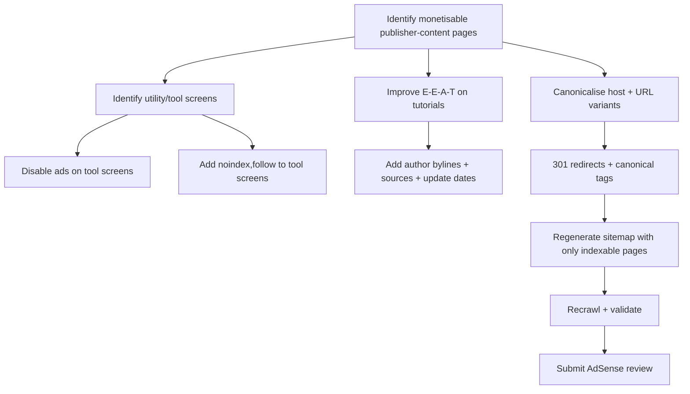
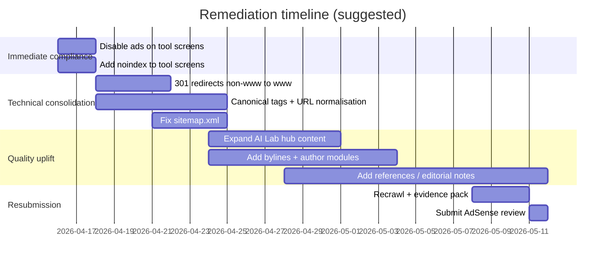

# learnstackhub.com AdSense “Low value content” Rejection Audit and Remediation Report

## Executive summary

learnstackhub.com has substantial long-form tutorial content (for example, the Core Java “Data Types” and “Java Introduction” articles are multi-section guides with code samples and interview Q&A). citeturn20view0turn21view1 However, the site also exposes multiple **utility / tool-like screens** (AI chat, live code editor, timed interview, MCQ exam runner) whose *primary* on-page content is UI, forms, or interactive behaviour rather than publisher content. citeturn33view0turn33view1turn35view0turn42view0 Google’s publisher policy explicitly disallows Google-served ads on screens without publisher content (or with low-value content), including navigation/behavioural screens and “dead end” pages such as login/thank you/error flows. citeturn60view0

In addition, the site appears to have **canonicalisation/duplication risk**: Google is discovering and surfacing pages on both `www.learnstackhub.com` and `learnstackhub.com` (non-www), with the same content accessible on both hostnames (example: “Why Maven?”). citeturn40view0turn38search12 This is a classic duplicated-content/cluster-splitting pattern and also creates the appearance of replicated content at the site level. citeturn62view0

Finally, crawling and indexing hygiene is inconsistent: `robots.txt` advertises a sitemap at `https://www.learnstackhub.com/sitemap.xml`, but retrieving that sitemap returned an error in this audit environment. citeturn25view2turn25view0 While sitemap availability is not a direct AdSense policy requirement, it is a strong signal of technical completeness and helps reduce the chance that reviewers land on thin/utility pages first.

**Most likely root cause of the AdSense “Low value content” rejection:** ad eligibility (or the review crawler’s landing pages) includes **screens without publisher content** (Practice Lab subtools, MCQ exam runner pages, and potentially other similar endpoints), which is directly covered by Google’s “Inventory value” policy. citeturn60view0turn42view0turn33view1turn33view0 A secondary contributor is sitewide duplication/canonical inconsistency (www vs non-www, and multiple variants for similar paths). citeturn40view0turn44search5turn44search6

## Methodology and data limitations

This report uses a best-effort crawl and content extraction approach suitable for a JavaScript-heavy site.

- Primary page extraction used a rendered-reader approach for pages that did not expose meaningful static HTML in this audit environment. citeturn51view0
- The homepage could not be reliably extracted (timeout in the reader), so homepage analysis is limited to indirect evidence (navigation repeated across key pages and crawl behaviour). citeturn37view0turn27view0
- “Top 20 pages by traffic” could not be determined because analytics access is not available and ownership verification status is unspecified. A sitemap is referenced in `robots.txt`, but the sitemap could not be retrieved successfully here; therefore, representative high-salience pages were selected from global navigation and search-discovered URLs. citeturn25view2turn25view0turn27view0
- Page-speed and mobile UX “scores” could not be collected reliably due to PageSpeed API rate limiting during audit execution; the report provides **targets** and **commands** to measure and attach results for resubmission evidence. citeturn48view0
- Plagiarism detection is implemented here as **(a)** internal duplication checks (canonical/hostname duplication) and **(b)** spot-checking for “generic definition overlap” risk using web comparators; comprehensive web-wide plagiarism scanning requires third-party tools (recommended below). citeturn40view0turn52search0turn62view0

## Crawl findings on content quality, duplication, and E‑E‑A‑T

### Page sample reviewed

The pages below are the primary evidence set for this report (URLs shown exactly as observed).

- Long-form tutorials (publisher-content pages):
  - `https://www.learnstackhub.com/tutorial/java-introduction` citeturn21view1
  - `https://www.learnstackhub.com/tutorial/java-data-types` citeturn20view0
  - `https://www.learnstackhub.com/tutorial/maven-why` and `https://learnstackhub.com/tutorial/maven-why` (duplication risk across hosts) citeturn40view1turn40view0
  - `https://www.learnstackhub.com/tutorial/core-java-mcq/` (exam landing/explainer page) citeturn43view0

- Utility / tool screens (low-value risk if ads enabled):
  - `https://www.learnstackhub.com/ai-lab` citeturn29view0
  - `https://www.learnstackhub.com/ai-lab/chat/` citeturn33view0
  - `https://www.learnstackhub.com/ai-lab/code-editor/` citeturn33view1
  - `https://www.learnstackhub.com/ai-lab/interview/` citeturn35view0
  - `https://www.learnstackhub.com/core-java-mcq` (exam runner) citeturn42view0

- Trust and legal:
  - `https://www.learnstackhub.com/about` citeturn26view1
  - `https://www.learnstackhub.com/contact` citeturn27view0
  - `https://www.learnstackhub.com/privacy/` citeturn46view0
  - `https://www.learnstackhub.com/terms/` citeturn46view1

- Crawling controls:
  - `https://www.learnstackhub.com/robots.txt` (references sitemap) citeturn25view2
  - Referenced sitemap URL fetch result: `https://www.learnstackhub.com/sitemap.xml` returned an error during audit. citeturn25view0

### Thin / low-value content patterns

**Pattern A: tool screens are mostly navigation + UI; minimal publisher content.**  
The AI chat page shows a header/navigation block and a short description (“Chat practice … AI tutor”) with no substantial editorial content on the page itself. citeturn33view0 The live code editor page similarly consists primarily of UI text (“Write code, run instantly…”) and editor controls plus a sample snippet, not an article. citeturn33view1 The MCQ exam runner page is largely rules and a name field (“Enter Your Name … Start Exam”) rather than publisher content. citeturn42view0 The AI interview page is also primarily rules for a timed interview tool. citeturn35view0

These are highly likely to be interpreted as **“screens without publisher-content”** if Google-served ads are present on them. citeturn60view0turn42view0turn33view1

**Pattern B: “boilerplate dominance” on some pages.**  
Several pages (contact, practice-lab pages, exam pages) include very large repeated navigation menus listing dozens of tutorials and categories. citeturn27view0turn29view0turn42view0 Even when a page has a purpose, a high boilerplate-to-content ratio can look like templated/low-value content, especially if ads are prominent. Google’s “Inventory value” guidance emphasises that publisher content should be “the focal point” of the page. citeturn60view0

### Duplicate / replicated content patterns

**Pattern C: www vs non‑www duplication is observable in the wild.**  
The “Why Maven?” content is accessible on both `https://learnstackhub.com/tutorial/maven-why` and `https://www.learnstackhub.com/tutorial/maven-why`, with the same tutorial text. citeturn40view0turn40view1 Additionally, search results show the non‑www variant surfaced/known externally (indicating search discovery). citeturn38search12 Similar duplication exists for exam pages (for example `learnstackhub.com/jdbc-mcq` vs `www.learnstackhub.com/jdbc-mcq`). citeturn44search5turn44search6

Google’s guidance on “thin content with little or no added value” explicitly calls out checking for content that duplicates content found elsewhere. citeturn62view0 While that guidance is framed in a Search Console manual action context, the same underlying quality principle applies to AdSense site quality reviews and “inventory value” determinations. citeturn60view0turn60view3

### Depth and value signals in long-form tutorial pages

Some tutorial pages demonstrate meaningful depth: structured breakdowns, code examples, “common mistakes”, and interview Q&A sections. citeturn20view0turn21view1turn40view0 This is a strong base for AdSense eligibility *if* the site’s ad inventory is constrained to these publisher-content pages. citeturn60view0

### E‑E‑A‑T and trust signals

There are good site-level trust foundations:

- An “About” page with mission, what the platform offers, and an author section naming **entity["people","Dattakumar Pandi","founder of learnstackhub"]** and describing experience and mission. citeturn26view1
- Contact information with emails and response-time expectations. citeturn27view0
- Privacy policy with clear disclosure of AdSense usage and AI chat processing caution (“Do not enter sensitive personal data in chat”). citeturn46view0turn29view0
- Terms of service addressing user contributions and advertising disclosures. citeturn46view1

Gaps that commonly hurt AdSense reviews, even when content is long:

- Tool pages that produce user-visible, AI-generated outputs risk being treated as automatically generated content; Google’s publisher guidance explicitly warns against placing ads on automatically generated content without manual review/curation. citeturn60view0turn29view0
- Per-article E‑E‑A‑T signals are inconsistent in the pages reviewed (some show “Updated …” metadata on content pages, others do not clearly show editorial review/author attribution inline). citeturn43view0turn20view0

## Policy mapping to the observed issues

### Publisher policy area most relevant to this rejection

The most directly applicable policy for this site’s current structure is **Inventory value**: “Google-served ads on screens without publisher-content”. citeturn60view0 Google states it does not allow Google-served ads on screens:
- without publisher-content or with low-value content,
- under construction,
- used for alerts, navigation, or other behavioural purposes. citeturn60view0

**Why this applies to learnstackhub.com (page-specific mapping):**

- `https://www.learnstackhub.com/ai-lab/chat/` – page is primarily a chat interface with minimal static publisher content; core content becomes AI-generated responses, which are not editorially curated by default. citeturn33view0turn60view0
- `https://www.learnstackhub.com/ai-lab/code-editor/` – page is a code-execution tool (“write code, run instantly”) and effectively a utility screen. citeturn33view1turn60view0
- `https://www.learnstackhub.com/ai-lab/interview/` – page is a timed behavioural flow that enforces fullscreen/tab-switch rules; it is fundamentally an interaction screen rather than a content page. citeturn35view0turn60view0
- `https://www.learnstackhub.com/core-java-mcq` – exam runner screen with security/behaviour rules and a start form (minimal publisher content). citeturn42view0turn60view0

Google further illustrates that ads should not be placed on “dead end” or “no content” screens (thank you/login/exit/error pages). While the above pages are not literally login pages, they function similarly as “utility screens” where the interaction—not reading content—is the primary activity. citeturn60view0turn61view0

### Replicated/duplicate content as a site-quality amplifier

Google’s Search quality documentation on thin content recommends checking duplicate content and pages that provide insufficient added value (thin affiliate, scraped content, doorways). citeturn62view0 Even if learnstackhub.com is not an affiliate site, the **mechanics** of “duplicated content found elsewhere” apply to technical duplicates such as:

- Same article reachable on both www and non‑www hostnames. citeturn40view0turn40view1turn38search12
- Multiple versions of similar exam pages across hostnames and paths (e.g., `learnstackhub.com/jdbc-mcq` vs `www.learnstackhub.com/jdbc-mcq`). citeturn44search5turn44search6

These patterns can cause reviewers (human or automated) to encounter what appears to be replicated content across the domain footprint, weakening “value” perception. citeturn60view0turn62view0

### Policy references to include in your internal compliance notes

- All AdSense publishers must comply with AdSense program policies and Google publisher policies. citeturn60view2turn60view1
- Google encourages publishers to focus on value and references Search spam policies as a best-practice baseline. citeturn60view3turn60view5

## Prioritised remediation plan with concrete changes

### Remediation principles

- **Concentrate ad inventory on editorial pages** (tutorials, category hubs, career guidance articles) and **remove or block ads** from utility screens. This aligns directly with the “screens without publisher-content” policy. citeturn60view0turn33view1
- **Canonicalise and consolidate duplicates** (www vs non‑www, slash vs no-slash where applicable, exam runner vs tutorial explainer). citeturn40view0turn44search5turn44search6
- **Make crawling predictable** (sitemap returns a clean 200 and lists only indexable publisher-content URLs). citeturn25view2turn25view0

### Highest priority fixes

#### Remove ads and/or noindex utility screens

Target pages (evidence sample):  
- `https://www.learnstackhub.com/ai-lab/chat/` citeturn33view0  
- `https://www.learnstackhub.com/ai-lab/code-editor/` citeturn33view1  
- `https://www.learnstackhub.com/ai-lab/interview/` citeturn35view0  
- `https://www.learnstackhub.com/core-java-mcq` citeturn42view0  

**What to do (concrete):**
- Ensure AdSense auto ads / ad units are disabled on these paths (route-based exclusions).
- Add `noindex,follow` meta robots (or X‑Robots‑Tag header) to tool screens that are not editorial content.
- Keep a single editorial landing page for each tool that *is* indexable (e.g., `/ai-lab` is acceptable as a hub page if expanded with richer publisher content and clear educational framing). citeturn29view0turn60view0

**Before/after example (chat page positioning):**

Before (current pattern, minimal educational content):  
> “Chat practice … AI tutor” citeturn33view0  

After (example rewrite to add publisher-content and reduce “utility screen” feel):  
- Add a full “How to use Chat Practice for interview prep” article section (800–1,200 words) including:
  - curated prompt packs,
  - rubric for evaluating answers,
  - examples of good vs poor answers,
  - links to the relevant tutorials for each topic,
  - a disclosure that chat output is unverified and ads are not shown on AI output screens. citeturn29view0turn60view0

#### Canonicalise www vs non‑www and eliminate duplicate host indexing

Evidence of duplication: “Why Maven?” exists on both hosts with the same content. citeturn40view0turn40view1

**What to do (concrete):**
- Choose one canonical host (recommend `https://www.learnstackhub.com` because that is used in navigation and legal pages). citeturn27view0turn46view0
- Enforce sitewide 301 redirects from non‑www → www.
- Ensure canonical tags point to the canonical host.
- Update internal links to always use canonical host.
- In Search Console, set the canonical domain property and submit the corrected sitemap. citeturn60view4turn25view2

#### Fix sitemap retrievability and ensure it contains only indexable content URLs

`robots.txt` advertises a sitemap URL, but that sitemap retrieval failed during audit. citeturn25view2turn25view0

**What to do (concrete):**
- Ensure `https://www.learnstackhub.com/sitemap.xml` returns 200, valid XML, and includes:
  - tutorials (publisher content),
  - category hubs (if they exist as content pages),
  - key trust pages (about, contact, privacy, terms).
- Exclude tool screens and exam runner screens from sitemap (since those should be noindex/no-ads). citeturn60view0turn42view0

### Second priority fixes that materially improve “value perception”

#### Expand publisher-content on tool landing pages

`/ai-lab` currently contains some explanatory text but is still relatively thin compared with the site’s tutorial depth. citeturn29view0 Expand it into a true “Practice Lab Guide”:

- learning outcomes,
- what is stored locally vs transmitted,
- examples of interview drills,
- links to relevant tutorial sequences,
- explicit statement that AI tool screens are not ad-monetised (if you implement that). citeturn46view0turn60view0

#### Strengthen per-article E‑E‑A‑T

The site-level “About” page is strong, but AdSense reviewers often assess whether editorial pages have clear ownership and accountability. citeturn26view1turn60view3

Concrete upgrades:
- Add consistent byline modules at the bottom of tutorial pages linking to the author bio (the author bio exists on `/about`). citeturn26view1turn20view0
- Add “Reviewed by” where applicable (even if only internal review).
- Add citation links for factual/history claims (e.g., Java history) to authoritative sources. (Your content currently overlaps common Java definitions found widely across the web; adding primary references reduces the “generic AI summary” impression.) citeturn52search0turn21view1

### UX and structural clean-ups

Even without measured performance scores, several structural improvements reduce “template” signals and improve user focus:

- Reduce the size of repeated mega-navigation blocks on non-hub pages; collapse into compact menus and add breadcrumb navigation instead (especially on mobile). Boilerplate repetition is visible across multiple pages. citeturn27view0turn33view1
- Add clear “Start here” paths per track (Core Java, HTML, CSS, etc.) and ensure these are strong category hub pages (publisher content pages). citeturn27view0turn26view1

### Remediation workflow diagram



## Resubmission checklist, evidence pack, and effort estimates

### Resubmission checklist

- Confirm you comply with Google publisher policy “screens without publisher-content” by removing ads from:
  - chat practice,
  - code editor,
  - interview mode,
  - exam runner pages. citeturn60view0turn33view0turn42view0
- Confirm canonical domain consistency:
  - non‑www redirects to www,
  - no duplicate host indexing remains for key pages. citeturn40view0turn38search12
- Confirm sitemap is accessible and accurate:
  - `robots.txt` points to a working sitemap (200 OK),
  - sitemap includes only indexable, content-rich pages. citeturn25view2turn25view0
- Confirm trust pages exist and are linked in footer:
  - About, Contact, Privacy Policy, Terms of Service. citeturn27view0turn46view0turn46view1
- Confirm content pages are the focal point (inventory value):
  - ads are not excessive compared to content,
  - content is prominent and navigable. citeturn60view0turn61view0
- (If site ownership verification is not set up) verify the site in **entity["organization","Google Search Console","webmaster tools"]** and ensure AdSense site access is correct before re-requesting review. citeturn60view4turn62view0

### Evidence to include (or be ready to provide) for AdSense review

- A short list of example “content-first” URLs (tutorials) that demonstrate depth (include at least 5–10). citeturn20view0turn21view1turn40view1
- Screenshots showing:
  - ads removed on tool screens (chat/editor/interview/exams),
  - visible author attribution modules on tutorials,
  - working sitemap in browser showing 200 and URLs.
- A redirect proof log:
  - `curl -I` outputs showing non‑www → www 301,
  - canonical tags in page source.
- A crawl report export (Screaming Frog or similar) showing:
  - tool pages `noindex`,
  - canonical consistency,
  - no duplicate content by URL variants.

### Effort and timeline estimates per fix

| Fix | Priority | Effort | Estimated hours | Notes / success metric |
|---|---|---:|---:|---|
| Disable ads on tool/utility pages (`/ai-lab/*`, exam runners) | Highest | Low–Med | 2–6 | Must align to “screens without publisher-content” policy. citeturn60view0turn42view0 |
| Add `noindex,follow` to tool screens (or block via X‑Robots‑Tag) | Highest | Low | 1–3 | Keeps them usable while removing them from index footprint. citeturn60view0turn60view5 |
| Force 301 redirects non‑www → www | Highest | Med | 2–8 | Eliminates duplicated host indexing; validate with logs. citeturn40view0turn38search12 |
| Add canonical tags (host + trailing slash convention) | High | Med | 4–10 | Prevents cluster splitting and “replicated content” impressions. citeturn62view0turn44search5 |
| Fix sitemap.xml availability and contents | High | Med | 4–12 | `robots.txt` already references it; must return valid XML. citeturn25view2turn25view0 |
| Expand `/ai-lab` into a richer publisher-content hub | Medium | Med | 6–14 | Converts a thin hub into a content page; improves review landing outcomes. citeturn29view0turn60view0 |
| Add consistent bylines + author box to tutorials | Medium | Med | 6–20 | Builds E‑E‑A‑T consistency beyond site-level about page. citeturn26view1turn20view0 |
| Add citations/references for factual claims on tutorials | Medium | Med | 10–30 | Reduces “generic/AI” appearance; improves trust. citeturn60view3turn21view1 |
| Navigation reduction (collapse giant menus; add breadcrumbs) | Medium | High | 12–40 | Improves UX and reduces boilerplate dominance. citeturn60view0turn27view0 |

### Suggested timeline diagram



## Measurement table and recommended targets

Because automated performance scoring was rate-limited during audit execution, the “current” performance fields are marked as **Not measured here** and the table provides **targets** and classification. citeturn48view0 Word counts are **estimates** based on extracted main content vs UI/boilerplate dominance.

| Page (current) | Type | Current content depth (qualitative) | Current risks | Recommended action | Target metrics (recommended) |
|---|---|---|---|---|---|
| `https://www.learnstackhub.com/tutorial/java-introduction` citeturn21view1 | Tutorial | High (long-form guide) | Generic definitions overlap risk; ensure citations | Keep indexed + monetisable | ≥1,500 words unique content, ≥1 original diagram, Article schema, mobile PSI >90 (measure) |
| `https://www.learnstackhub.com/tutorial/java-data-types` citeturn20view0 | Tutorial | High (examples + interview Q&A) | None critical; ensure author/citations consistency | Keep indexed + monetisable | ≥1,500 words, ≥1–2 unique images/diagrams, Article + FAQ schema, mobile PSI >90 |
| `https://www.learnstackhub.com/tutorial/maven-why` citeturn40view1 | Tutorial | High | Duplicate host variant exists | Keep indexed; fix canonical/redirect | Single canonical URL, no duplicate hosts, Article schema |
| `https://learnstackhub.com/tutorial/maven-why` citeturn40view0 | Duplicate host | Same as above | Replicated/duplicate content | 301 → www + canonical | 0 indexable pages on non‑www host |
| `https://www.learnstackhub.com/tutorial/core-java-mcq/` citeturn43view0 | Explainer page | Medium | None major | Keep indexed; monetise if content-first | Expand to 800–1,200 words; add sample questions and learning guidance |
| `https://www.learnstackhub.com/core-java-mcq` citeturn42view0 | Exam runner | Low (utility screen) | “screen without publisher-content” risk | No ads + noindex | Noindex, no ads, performance target irrelevant |
| `https://www.learnstackhub.com/ai-lab` citeturn29view0 | Hub | Low–Medium | Could be thin; leads to tool screens | Expand as publisher-content hub | 800–1,200 words hub guide; internal links to tutorials; Breadcrumb schema |
| `https://www.learnstackhub.com/ai-lab/chat/` citeturn33view0 | Tool | Low | Ads on AI output screen risk; auto-generated content caution | No ads + noindex (or heavy content expansion + no ads on output area) | No ads; noindex; add a separate indexable “how to use” guide page |
| `https://www.learnstackhub.com/ai-lab/code-editor/` citeturn33view1 | Tool | Low | Utility screen risk | No ads + noindex | No ads; noindex; optionally gated behind login |
| `https://www.learnstackhub.com/ai-lab/interview/` citeturn35view0 | Tool | Low | Behavioural/interaction screen risk | No ads + noindex | No ads; noindex; provide separate indexed explainer article |

## Recommended tools and commands for duplicate detection, crawling, and UX measurement

### Crawling and indexability

- Screaming Frog SEO Spider (free tier crawls up to 500 URLs) to export:
  - status codes,
  - canonical tags,
  - meta robots,
  - duplicate titles/descriptions,
  - thin page word counts.

Example commands/checks (CLI-style where applicable):

```bash
# Verify canonical host redirect (expect 301 non-www -> www)
curl -I https://learnstackhub.com/tutorial/maven-why

# Verify sitemap resolves
curl -I https://www.learnstackhub.com/sitemap.xml

# Spot-check robots reference
curl -s https://www.learnstackhub.com/robots.txt
```

### Duplicate content / similarity detection

- Use shingle-based similarity on exported HTML/text:
  - Export page text from Screaming Frog (“Extraction”).
  - Run a local MinHash/SimHash script to find near-duplicates (highly effective for template-heavy sites).

Example (conceptual) Python process:

```bash
# After exporting extracted text files, compute similarity
python detect_near_duplicates.py --input exported_text/ --threshold 0.9
```

For web-wide plagiarism checks (not just internal duplicates), use tools like Copyscape or Originality-style checkers (commercial), or spot-check by searching distinctive sentences in quotes.

### Performance and mobile UX

- Lighthouse (Chrome DevTools) and PageSpeed Insights (mobile + desktop).
- Target the tutorial pages reviewers will likely land on first; also test the heaviest template pages.

Example Lighthouse CLI:

```bash
lighthouse https://www.learnstackhub.com/tutorial/java-data-types --view --preset=desktop
lighthouse https://www.learnstackhub.com/tutorial/java-data-types --view --preset=mobile
```

If you use PageSpeed Insights API, capture and attach reports as evidence; note that API access can be rate-limited without a key. citeturn48view0

## Sample AdSense resubmission text

Below is a suggested review request/appeal narrative tailored to the specific issues found.

> Hello AdSense review team,  
> We have made substantial changes to ensure our site provides high-value publisher content and complies with Google Publisher Policies.  
>  
> **Inventory value / low-value screens:** We identified that several interactive utility screens (Practice Lab chat, live code editor, interview mode, and MCQ exam runner pages) contain minimal publisher content and are primarily behavioural/utility experiences. We have removed Google-served ads from these screens and added noindex directives where appropriate, so ads are only served on our editorial tutorial pages and content hubs.  
>  
> **Duplicated URL variants:** We consolidated our site to a single canonical domain and implemented permanent redirects so duplicate host variants no longer exist.  
>  
> **Site quality improvements:** We expanded our content hubs, strengthened internal linking, added consistent author attribution and editorial information, and ensured our sitemap and crawl directives reflect only indexable publisher-content pages.  
>  
> We believe these updates address the previous “Low value content” feedback and would appreciate a re-review of the site. Thank you.

This wording is aligned with Google’s publisher policies emphasising that content should be the focal point and that ads should not appear on screens without publisher content. citeturn60view0turn60view2turn60view1