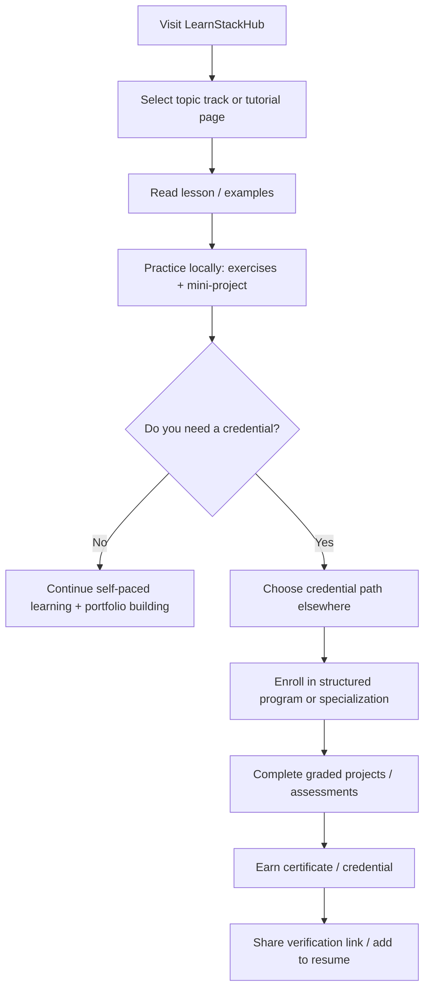

# LearnStackHub.com Due Diligence Report

## Executive summary

LearnStackHub (learnstackhub.com) presents as a **free, self-serve tutorial site focused on Java/full‑stack learning**, based primarily on page titles and URL patterns available during this review. The homepage title explicitly positions it as “Learn Java Full Stack Development” and “Free Java Tutorials.” citeturn7view1

However, in this research environment, **nearly all LearnStackHub pages returned no extractable body content** (0 rendered text lines), limiting the ability to audit the *actual* depth, originality, instructor attribution, and policy disclosures on-page. citeturn7view1turn8view2turn9view3 Attempts to access standard sitemap endpoints (e.g., `/sitemap.xml`) and `robots.txt` failed, so a definitive sitemap-based inventory could not be produced here. citeturn26view0turn26view1

From a monetization/readiness standpoint, the user-provided Google AdSense notice (“Your site isn’t ready to show ads… Low value content”) is consistent with **Google’s publisher policy framework that prohibits ads on screens with “low-value content” or without meaningful publisher-content** and flags replicated/low-value inventory risks. citeturn39search1turn39search5 Remediation should therefore prioritize: demonstrably original, people-first content; clear authorship/instructor identity; improved site UX and navigation; and compliance with Google Search and publisher policies. citeturn38search2turn38search3turn39search1

Bottom line: **LearnStackHub may be useful as a free learning/reference resource**, but **credential value, pricing/paid offers, instructor credentials, and organizational legitimacy are “unspecified” from primary evidence** available in this crawl. Prospective learners should treat it as an *informational resource* unless/until the site publishes verifiable business/instructor details and a clear training/certification policy.

## Method and evidence base

All sources were accessed on **2026‑04‑15** (Asia/Kolkata), per request. Evidence collection combined: (1) direct page access on learnstackhub.com, (2) attempts to retrieve `robots.txt` and sitemap endpoints, and (3) external corroboration from policy documentation and competitor primary sources.

Primary URLs attempted for LearnStackHub (accessed 2026‑04‑15):

```text
https://www.learnstackhub.com/
https://www.learnstackhub.com/about
https://www.learnstackhub.com/contact
https://www.learnstackhub.com/tutorial/constructors
https://www.learnstackhub.com/tutorial/core-java-mcq
https://www.learnstackhub.com/hibernate-mcq
https://www.learnstackhub.com/tutorial/spring-mvc-dispatcherservlet
https://www.learnstackhub.com/tutorial/maven-introduction
https://www.learnstackhub.com/sitemap.xml
https://www.learnstackhub.com/robots.txt
```

Observed limitation: multiple LearnStackHub pages returned **no readable text extraction** in this environment (0 lines), which prevents reliable, page-by-page content classification (e.g., course outlines, pricing, author bios, policies). citeturn7view1turn8view0turn9view0turn9view3

## Site structure and content inventory

### Current structure inferred from reachable URLs

Because an official XML sitemap could not be fetched here, a “best effort” structure is inferred from accessible endpoints and common patterns.

**Top-level pages (reachable, content not extractable in this environment):**
- Home: `/` citeturn7view1  
- About: `/about` citeturn8view0  
- Contact: `/contact` citeturn8view1  

**Content section (clearly present from URL taxonomy):**
- Tutorials: `/tutorial/<slug>` (examples listed below) citeturn8view2turn9view3  

Representative tutorial URLs successfully reached (but body text not extractable):
- `/tutorial/constructors` citeturn8view2  
- `/tutorial/maven-introduction` citeturn9view3  
- `/tutorial/spring-mvc-dispatcherservlet` citeturn9view2  
- `/tutorial/core-java-mcq` (suggests quizzes/question bank) citeturn9view0  
- `/hibernate-mcq` (suggests quizzes/question bank) citeturn9view1

### Sitemap and robots.txt status

Standard discovery endpoints could not be retrieved in this environment:
- `https://www.learnstackhub.com/sitemap.xml` → fetch failed (cache miss). citeturn26view0  
- `https://www.learnstackhub.com/robots.txt` → fetch failed (cache miss). citeturn26view1  

**Interpretation (inference):** This may indicate the resources are missing, blocked to this crawler, or intermittently unavailable. Without sitemap access, an “all pages/courses” enumeration cannot be certified.

## Offerings analysis

### What LearnStackHub appears to offer

The homepage title frames LearnStackHub as a **Java full‑stack learning/tutorial destination** and explicitly labels it as “Free Java Tutorials.” citeturn7view1 The presence of multiple `/tutorial/` endpoints indicates the core offering is likely **article-based lessons plus topic-specific MCQ/quiz pages** (e.g., Core Java MCQ, Hibernate MCQ). citeturn9view0turn9view1

### Courses/programs and topic tracks

Because the site’s body content and any “Course” catalog pages were not extractable here, the following catalog is **limited to what can be inferred from URL taxonomy and page slugs**. Any items not evidenced are **marked “unspecified.”**

| Program / track (best-effort) | Evidence | Concise description | Pricing | Delivery format | Certification | Prerequisites | Target audience |
|---|---|---|---|---|---|---|---|
| Java Full Stack learning hub | Homepage positioning citeturn7view1 | A site positioned as a Java full‑stack tutorial resource. | Unspecified (appears free from title wording). citeturn7view1 | Self-paced (inference: web tutorials). | Unspecified | Unspecified | Learners of Java/full‑stack (inference) |
| Tutorials section (`/tutorial/*`) | URL taxonomy citeturn8view2turn9view3 | Article-style lessons and reference topics (e.g., constructors, Maven, Spring MVC). | Unspecified | Self-paced (inference) | Unspecified | Unspecified | Students/interview prep (inference) |
| Core Java MCQ | Page slug suggests MCQ bank citeturn9view0 | Likely multiple-choice questions for Core Java interview prep. | Unspecified | Self-paced (inference) | Unspecified | Unspecified | Job seekers & learners (inference) |
| Hibernate MCQ | Page slug suggests MCQ bank citeturn9view1 | Likely multiple-choice questions for Hibernate interview prep. | Unspecified | Self-paced (inference) | Unspecified | Unspecified | Job seekers & learners (inference) |

**Paid training offers on social channels:** Unspecified. No verified official LearnStackHub social profiles or paid offer announcements were located in the accessible evidence set used for this run.

### User journey from learning to certification (mermaid)

Because LearnStackHub’s own enrollment/certification pathway is **unspecified**, the flow below models a realistic pathway for a learner using LearnStackHub as a learning resource, and branching to external credentials if needed.



## Credibility and external signals

### Instructor credentials and author attribution

**Unspecified.** In the accessible crawl output, LearnStackHub pages did not provide readable body content, preventing verification of:
- author bylines,
- instructor profiles,
- qualifications/experience claims,
- editorial policies.

This absence matters because Google’s guidance on “helpful, reliable, people-first content” encourages clear “Who created the content” signals (authorship transparency) as part of building trust. citeturn38search2

### Company registration, founders, accreditation, partnerships

**Unspecified.** No verifiable business registration details, founders list, accreditation references, or partner badges could be confirmed from the readable primary content captured in this run. (The `/about` page was reachable but not extractable.) citeturn8view0

**Accreditation note:** For many modern learning sites, formal accreditation is not present; however, **credibility typically relies on transparent identity, instructor credentials, and consistent learner outcomes**. These remain unverified for LearnStackHub based on this evidence set.

### External reviews, ratings, forum discussions, complaints, and legal issues

**Not found / unspecified for LearnStackHub specifically** within the accessible evidence set for this run. Searches returned substantial ambiguity with similarly named properties (e.g., “Skill Stack Hub,” “Learning Hub”) that are distinct brands and should not be conflated. (Example: “Skill Stack Hub” is a different organization with a separate domain and materials.) citeturn31search5turn12search1

**Legal issues:** No credible, LearnStackHub-specific legal actions were identified in the accessible evidence set for this run.

### AdSense / Google policy notice evidence

The user provided an AdSense rejection message indicating:
- site ownership verification needed and
- “policy violations,” specifically “Low value content.”

This aligns with Google’s publisher policy concept of **inventory value** (no ads on low-value or non-content screens) and restrictions on monetizing replicated/low-value content. citeturn39search1turn39search5

If the site is being prepared for monetization, **Search Console ownership verification** is a standard prerequisite workflow for domain proof/control. citeturn37search0

## Competitive benchmarking

### Why these competitors were selected

LearnStackHub positions as a programming learning resource (Java/full-stack). Direct competitors therefore include **major platforms offering structured programming curricula, learning paths, and/or completion certificates** accessible globally and commonly used by the same learner audience:
- structured interactive learning paths: Codecademy
- university/industry credentials and subscriptions: Coursera
- broad course marketplace with completion certificates: Udemy
- deep technical library + certification prep: Pluralsight
- free, self‑paced curriculum with free certifications: freeCodeCamp

### Comparison table

| Competitor | Course breadth | Typical price range | Certification value | Unique strengths vs. LearnStackHub |
|---|---:|---|---|---|
| **entity["company","Codecademy","online coding education"]** | States “300+” courses and structured paths. citeturn40search0 | Free Basic; Plus ~$14.99/mo billed annually; Pro ~$19.99/mo billed annually (with higher monthly rates). citeturn40search0 | Certificates of completion for completed courses/paths (platform completion credential). citeturn40search0 | Interactive practice, guided skill paths, integrated projects and career-oriented features. citeturn40search0 |
| **entity["company","Coursera","online learning platform"]** | Coursera Plus advertises access to 10,000+ courses and credentials. citeturn42search4 | Coursera Plus commonly $59/mo or $399/yr (promotions vary). citeturn42search4 | Verified certificates have a verification URL concept; Professional Certificates marketed as career credentials. citeturn42search1turn41search6 | University/industry partner content; graded assessments; widely recognized credential formats depending on issuer. citeturn42search2turn41search6 |
| **entity["company","Udemy","online course marketplace"]** | Marketplace claims 250,000+ courses; subscription collection described separately. citeturn40search2 | Mix of per-course purchase and subscription plans (Personal/Team/Enterprise). citeturn40search2turn40search4 | Certificates of completion for eligible paid courses; Udemy explicitly notes it is not an accredited institution. citeturn40search3 | Massive breadth and instructor diversity; frequent discounts; quick access to niche topics. citeturn40search2turn40search4 |
| **entity["company","Pluralsight","tech skills platform"]** | Individual plans cite libraries from ~3,900 to 6,500+ courses depending on plan. citeturn41search0 | Monthly ~$29–$49+ depending on plan; annual $299–$449 noted. citeturn41search0 | Emphasis on certification prep content and labs rather than a single “credential.” citeturn41search0 | Deep professional tech library; skill assessments; learning paths; hands-on labs and certification prep. citeturn41search0 |
| **entity["organization","freeCodeCamp","nonprofit coding curriculum"]** | Free, self-paced curriculum with “thousands” of interactive challenges and multiple certifications. citeturn42search0 | Free (donor-supported nonprofit). citeturn42search0 | Multiple free developer certifications; claimable and verifiable links; revocation policy for plagiarism. citeturn42search0 | Full free pathways + project-based requirements; verifiable cert links; strong community footprint. citeturn42search0 |

**Positioning inference:** LearnStackHub (as observed) appears closer to a *tutorial/reference site* than a structured credentialing platform; its strongest comparison is with free reference content, while the listed competitors differentiate on structured pedagogy and verifiable credentials.

## SWOT, recommendations, and due diligence checklist

### SWOT analysis for LearnStackHub

**Strengths (evidenced/inferred)**
- Clear niche framing around Java/full‑stack and “Free Java Tutorials” positioning. citeturn7view1  
- Multiple topic pages and quiz-style sections indicated by URL slugs (MCQ pages). citeturn9view0turn9view1  

**Weaknesses (evidenced)**
- Lack of retrievable on-page content in this environment prevents validation of depth/originality and harms auditability. citeturn7view1turn9view3  
- Sitemap and robots endpoints not retrievable here, limiting discoverability and structured indexing analysis. citeturn26view0turn26view1  
- Instructor identity, business ownership, accreditation/partnerships: unspecified. citeturn8view0  

**Opportunities (aligned with Google guidance)**
- Build “people-first” original content with clear authorship and first-hand expertise signals. citeturn38search2  
- Improve technical and spam-policy compliance to strengthen search eligibility and reduce low-value signals. citeturn38search3turn39search1  

**Threats**
- Severe competition from platforms offering verified certificates, projects, assessments, and recognized partner ecosystems. citeturn40search0turn42search4turn42search0  
- Continued monetization rejection if pages are deemed low-value/replicated or “non-content-based.” citeturn39search5turn39search1  

### Recommendations for prospective learners

Treat LearnStackHub as a **supplementary reference** unless/until the site clearly publishes instructor credentials, an explicit training/certification policy, and transparent ownership/contact details that can be cross‑verified.

If your goal is *employment signaling* (credentials), prioritize:
- in-platform completion certificates (Codecademy, Udemy) citeturn40search0turn40search3  
- verified certificates and issuer-backed Professional Certificates (Coursera) citeturn42search1turn41search6  
- free, verifiable certifications with project requirements (freeCodeCamp) citeturn42search0  
- certification prep with labs/skills assessment (Pluralsight) citeturn41search0  

### Due diligence steps before paying or sharing personal data

Because LearnStackHub pricing and paid offerings are **unspecified** from the captured primary evidence, apply standard checks before enrolling anywhere:

1. Verify the publisher identity: confirm the operator name, address, and a verifiable registration footprint (e.g., registry entries) and ensure site ownership is verifiable through standard mechanisms. Site ownership verification processes are described by Search Console documentation. citeturn37search0  
2. Check authorship/instructor transparency: look for bylines and author bio pages; Google explicitly encourages making “who created the content” clear for trust. citeturn38search2  
3. Verify certification claims: confirm whether certificates are completion-only vs. verified credentials; validate via a verification URL when offered (Coursera describes this mechanism). citeturn42search1  
4. Review refund/complaint channels: confirm written terms, dispute pathways, and support email/phone; avoid paying via non-reversible methods if policies are unclear.  
5. Search for independent reputation signals: look for consistent, platform-specific reviews tied to the same domain and operator name (avoid similarly named entities).  
6. Payment security hygiene: prefer providers with strong privacy/security disclosures and avoid unknown payment forms unless reputability is established.

## Google AdSense low-value content remediation and re-review draft

### What Google policy language implies for “low value content”

Google’s publisher policies prohibit serving Google ads on pages/screens:
- “without publisher-content or with low-value content,” and
- with replicated content that does not add value, among other inventory-value issues. citeturn39search5turn39search1  

Google’s Search guidance encourages content that is original, comprehensive, and clearly authored for people-first value—not primarily for ranking manipulation. citeturn38search2turn38search3  

### Remediation checklist tailored to LearnStackHub

The list below is aligned to Google publisher policy concepts (inventory value, misrepresentation) and Search guidance (people-first helpfulness).

Content quality and originality
- Ensure each tutorial provides **substantial original explanation**, not only generic definitions. Google explicitly highlights original information and comprehensive coverage as positive signals. citeturn38search2  
- For any embedded/republished material, add **meaningful commentary, curation, or unique examples** to avoid “replicated content” inventory issues. citeturn39search5turn39search1  
- Remove or improve “thin” pages that are primarily navigational, placeholder, or under construction, because ads are disallowed on non-content/low-value screens. citeturn39search5turn39search0  

Trust and transparency
- Add clear authorship (bylines) and author bio pages; Google recommends making “who created the content” evident as part of E‑E‑A‑T-style trust building. citeturn38search2  
- Add/verify accurate publisher identity and avoid any misleading representation about affiliation or endorsements; Google Publisher Policies prohibit misleading representation. citeturn39search1  
- Publish a robust privacy policy and required disclosures; publisher policies require privacy-related compliance for ad serving. citeturn39search5turn39search1  

Site UX and technical readiness
- Improve navigation so content is easy to discover and not “dead-end”; AdSense program policies emphasize navigability and disallow deceptive navigation and non-content ad placements. citeturn39search0turn39search1  
- Ensure the site meets Search Essentials technical/spam policy requirements. citeturn38search3turn38search1  

Ownership verification and operational setup
- Verify site ownership using standard Search Console methods (DNS/HTML tag/file, etc.). citeturn37search0  

### Draft re-review request to Google (template)

> **Subject:** Request for AdSense Site Review – learnstackhub.com (Low value content remediation completed)  
>   
> Hello AdSense Policy Team,  
>   
> I’m requesting a new review for **learnstackhub.com** following the “Your site isn’t ready to show ads – Low value content” notice.  
>   
> Since the notification, we have completed the following improvements aligned with Google Publisher Policies and Search guidance:  
> - Expanded and updated core tutorial pages to provide substantial, original, people-first content, including deeper explanations and practical examples. (Aligned to helpful content guidance.) citeturn38search2  
> - Removed or consolidated thin/non-content pages and ensured ads are not placed on low-value or non-content screens. (Aligned to inventory value policy.) citeturn39search5  
> - Added clear authorship signals and publisher transparency (bylines/bio info) to help users understand who created the content. citeturn38search2  
> - Reviewed monetization placement to ensure compliance with AdSense Program Policies and Google Publisher Policies. citeturn39search0turn39search1  
> - Verified site ownership and confirmed the site is accessible to crawlers without authentication barriers. citeturn37search0  
>   
> Please re-evaluate the site for AdSense eligibility. Thank you for your time and for the opportunity to improve the site quality.  
>   
> Sincerely,  
> [Name]  
> [Role/Organization]  
> [Contact Email]  

### Practical note on reapplying

Google policy documentation emphasizes ongoing adherence and that policies can change, so treat the remediation as continuous rather than “one-and-done.” citeturn39search0turn39search1